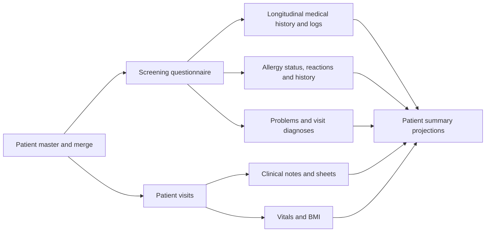
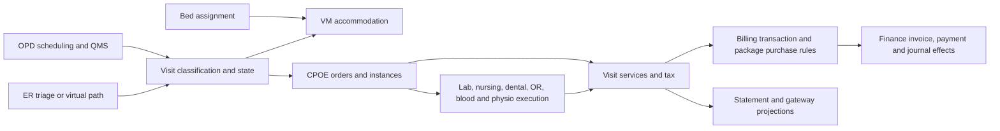
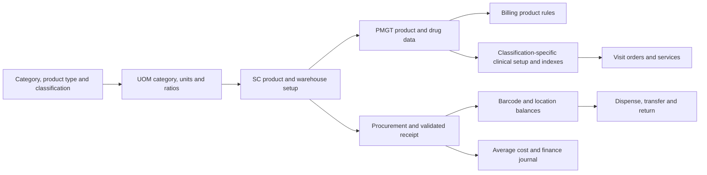

# DotCare database flow study

Captured 21 October 2026 from AHJ Prelive, using read-only queries, source excerpts and the user's business explanations. No patients, visits, products, permissions or configuration were changed; no sync, repair, cancellation or external-message operation was executed.

The study now covers **48 visible object-bearing schemas**: 44 with **2,042 base tables**, plus BIReport, Gateway, impreports and PatientSummery. The earlier inventory counted only schemas with tables. Start with [the schema ledger](module-map.md); it links every schema's observed flow, setup/context and all-table worksheet.

## Evidence captured

| Study pass | Captured result | Practical limit |
|---|---:|---|
| Base-table contracts | 22,882 columns; indexes and FK mappings | Visible snapshot; environment/version-specific |
| Base-table samples | All 2,042 tables; 3,567 rows | TOP2 identifier/state samples; 98 tables presence-only |
| Declared relationship samples | 2,132 constraints; 3,723 child samples | Not exhaustive integrity or business ownership |
| Shared patient/visit/product cohorts | 120 indexed queries | TOP5 per predicate; nonindexed candidates deferred |
| Setup vocabulary/configuration keys | 654 bounded queries | TOP31; configuration values not indiscriminately exported |
| Database-owned logic contracts | 1,415 SQL objects; 12,336 output columns; 2,979 parameters | Contracts/dependencies, not every body individually reviewed |
| SQL dependency rows | 6,359 | Dynamic SQL and external code can be absent |
| Event subscription discovery | 162 source matches; 22 flagged commented | Two branches; startup/deployment/delivery require confirmation |

Constraint count is scoped by child schema/table/name: matching constraint names across schemas are distinct. The earlier name-only total was corrected.

## Patient perspective

Patient-level records can have a visit context without being owned exclusively by that visit. Screening orchestrates changes to other modules before storing its own snapshot. Patient merge consumers can update selected transferred visits and copied patient display fields. The allergy summary view named “per visit” is patient-wide; the reviewed note summary is signed-only. Neither display behavior establishes deletion ownership.

## Visit perspective

The service path is conditional. Nursing compares requested/performed/charged quantities; OR calls VM according to configuration; planned dental items differ from performed insured procedures. Packages have separate header, purchase snapshot, assignment and member identities. A cancellation/reversal is therefore a workflow across these owners, not a single IsDeleted update.

## Product perspective

Classification-specific setup is more than copying a product row. A medication participates in drug/trade-name indexing; laboratory products need investigation/sample/component setup; dental procedures require treatment-area mapping; packages require master terms and historical purchase snapshots. Validated receipts update balance, valuation, procurement status, Finance and PMGT effects. Saudi integration branches are environment-dependent.

## Important findings now recorded

- **CPG visit definitions are not patient encounters.** CPGVisitNeed.VisitId points into CPG setup; do not join/delete it as a VisitMgt.Visit child because of its name.
- **HSM routing is assignment-dependent.** Changing room classification can remove an old ER/OR copy and create/update another; OPD nurse-station specialty handling has a separate condition.
- **HR synchronization is understood from its live procedure.** Proc_SyncData stages organization units, positions and employees; watermarks and local-to-universal mapping matter. It was not executed, and the test job is inactive as confirmed by the user.
- **SC has generated database fields.** Three enabled insert triggers generate barcode/code and transfer/return prefixes.
- **Reporting is not automatically read-only.** itreports includes custom procedures that write core setup/status; these are not automatically safe general migration adapters.
- **Projection filters differ.** Signed notes, final-result timing, insured tax and patient-wide allergies have different predicates. NULL deletion flags can behave differently between ISNULL(...,0)=0 and <>1.
- **Test data is inconsistent in places.** The sampled medication order-set links included missing parents; the earlier Security aggregate checks found orphan links. These were preserved as observations, not repaired or promoted into normal business rules.
- **External and historical state differ from current caches.** Notifications, search indexes, claim requests, message errors, jobs and purchase-time package terms need owner-specific handling.

Read [cache writers](cache-writers.md), [Security](security-flow.md), [visit/package details](core-flows.md) and the [action-script design rules](action-script-design.md) before designing maintenance operations.

## What this establishes

The broad schema/sample/dependency pass is complete for the visible database snapshot, and the skill now contains schema-specific flow findings with source and sample evidence. It does **not** certify every deployed code branch or external integration end-to-end. Specific unresolved writers and unsupported branches remain stated in the schema findings. Before generating an action script, verify the selected record's actual ownership, configuration and reversal path rather than treating a two-row sample or FK graph as exhaustive coverage.
