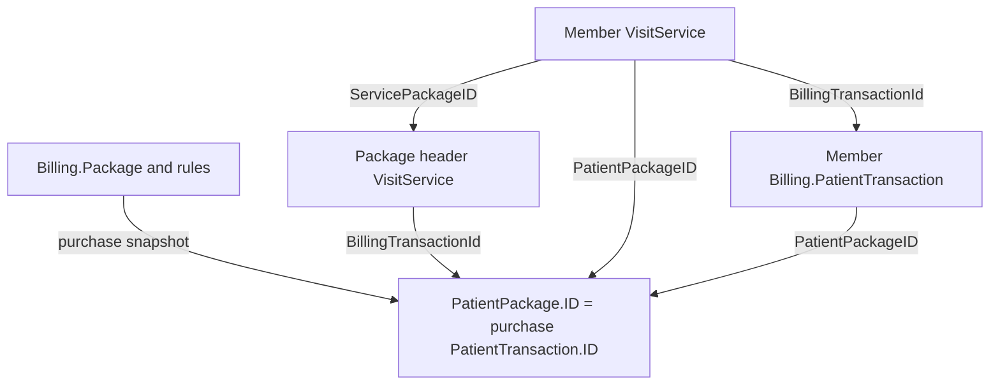
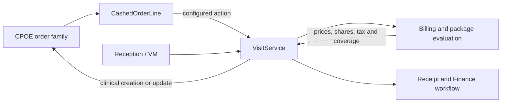
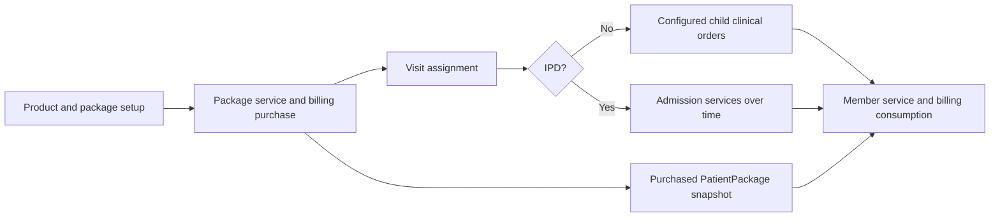

# DotCare HMIS: Visit, Service and Package Flows

21 October 2026 | AHJ Prelive | Read-only architecture and sample-data study

## 1. Evidence and executive view

This study follows OPD, IPD, ER and ambulatory visits through clinical orders, services, billing, taxes, payments, packages and downstream copies. Environment: **AHJ-HMISDBTest1 / AHJ.Env.HCMS_prelive**, entity **102**. All database operations were read-only; no HMIS records were changed.

**Data-quality context:** you advised that scripts may have changed test records. Therefore unusual sample values are observations, not confirmed product defects or proof of normal behavior. Intended behavior is described from local business code and supported relationships. The exact deployed binary/branch was not verified.

| Example | Visit ID | Active services | Package headers | Linked members |
| --- | --- | --- | --- | --- |
| OPD | 1424213 | 13 | 1 | 11 |
| IPD | 1415380 | 95 | 3 | 89 |
| Ordinary ER | 1402590 | 6 | 1 | 0 |
| AMB package purchase | 1422482 | 2 | 1 | 0 |
| AMB direct services | 1424316 | 2 | 0 | 0 |
| Virtual ER | 1424347 | 11 | 0 | 0 |

The snapshot contains **138 service rows: 129 active and 9 cancelled**. All 129 active service-to-billing links matched the visit, service and product identities. The **123 non-null clinical order links** resolved through 103 unified `CPOE.Orders` records and 20 specialized medication records. A blanket join to legacy `CPOE.OrderLine` would miss these links.

The coverage pass counted **95 indexed candidate paths**; 63 contained rows across 54 tables. Key matches alone do not prove business ownership, particularly for polymorphic order IDs. There were 71 distinct sampled products, present in SC, Billing and PMGT product tables.

The central finding is that **a package purchase, its visit assignment, its clinical expansion and its consumption are different records and different actions**. Treating the package as one isolated VisitService row loses that distinction.

## 2. Identity map: never interchange these keys

<!-- diagram:identity -->

| Object or field | Meaning and supported relationship |
| --- | --- |
| `VisitMgt.Visit.ID` | The encounter/container. Classification and type are separate attributes. |
| `VisitService.ID` | One financial/service transaction. A package header is also a row here, classification 8. |
| `VisitService.ServiceID` | Product identity; not another VisitService ID. |
| `VisitService.BillingTransactionId` | The service's own `Billing.PatientTransaction.ID`. |
| `VisitPackagesAssignment.PackageServiceID` | The purchased package header's `VisitService.ID`. Matches your earlier clarification, local source and sample data; no FK for this particular field was returned. |
| Member `ServicePackageID` | Package header `VisitService.ID`; a visible self-FK declares it. |
| Member `PatientPackageID` | Purchased-package transaction/snapshot identity. |
| `Billing.PatientPackage.ID` | Shared primary key with the purchase `Billing.PatientTransaction.ID`. |
| `Billing.PatientPackage.PackageID` | Master `Billing.Package.ID`; this is neither the product ID nor the service ID. |
| Member billing transaction | Has its own ID, plus purchased-package, package definition, detail/term references and `Inquantity`. |

The member service's `BillingTransactionId` is its own billing row, **not** the header's purchase ID. Its `PatientPackageID` points to the purchase. The package header normally has no `PatientPackageID`, because it is the purchase rather than a member consuming that purchase.

These conclusions combine visible FKs, purchase/assignment source and sample identity equality. Cross-module application links often lack FKs. Missing constraints must not be interpreted as missing business dependencies. [DB metadata and package trace; S07, S11, S15]

## 3. Visit creation and classification-specific context

`VisitBusinessRule.GetInstance` selects separate OPD, IPD, ER and AMB flows. OPD also branches on appointment configuration. Shared work maps patient/physician/specialty snapshots, financial information, status history and episode context. [S02-S06]

| Classification | Context and different behavior |
| --- | --- |
| OPD = 1 | `VisitAppointment`; booking, physician, clinic and appointment rules. Examination/default services depend on visit type, specialty and mappings. |
| IPD = 2 | `VisitAdmission`; optional `VisitAdmissionOrder` from a prior encounter; admitting doctor, accommodation/bed and effective room-class lifecycle. |
| AMB = 3 | Service-focused encounter. The reviewed refactored constructor has no mandatory classification-specific child and returns physician 0 at creation. Legacy `AmbulatoryVisitDetails` rows exist in the samples; do not turn this old extension into a universal requirement. |
| ER = 4, ordinary | `VisitTriageDetail`; triage, arrival, acuity, bed/zone and assigned doctor. |
| ER = 4, virtual | The reviewed constructor skips ordinary triage for virtual type 9; the sample has `VirtualVisitDetails`. |

Classification is **not** `VisitTypeID`: the examples use OPD type 1, IPD type 102, AMB type 8, ordinary ER type 100 and virtual ER type 9. It is also separate from financial status: the live lookup defines Cash=1 and Insured=2.

IPD may reference the originating CPOE admission request through `VisitAdmissionOrder.OrderID`, `OrderlineID` and `AdmittedFromvisitID`. During repricing, the effective accommodation class at the service time can affect pricing. A room move does not change the product identity, but can change the applicable charge context. [S04, S09]

The presence of an extension in one sample does not prove it is mandatory in every configuration or source version. Patient, physician, specialty, room and product names stored on transactions are snapshots/projections; they are not additional independent masters.

## 4. Service creation: two entry directions

<!-- diagram:entry -->

**VM/reception first:** validate allowed action, visit state and product rules; add VisitService; attach approval/package context; call Billing; update clinical orders where required. Stockable workflows additionally invoke warehouse/dispense actions. [S07]

**CPOE first:** clinical order changes are cached in `VisitMgt.CashedOrderLine`. Callback configuration, automatic-service rules and/or an explicit charging action determine when a VisitService is created. A cached order is not itself a completed charge. [S08]

Requested, charged, accepted, performed and dispensed quantities are different lifecycle measures. They must not be populated by copying one quantity into every column.

| Entity 102 setting | OPD | IPD | AMB | ER |
| --- | --- | --- | --- | --- |
| `SetAcceptedQuantityConfiguration` | False | True | False | False |

The source initializes accepted quantity from charged quantity only when configured. In other cases, valid-receipt/payment checks can gate acceptance. This is configurable behavior, not a universal property of the visit class. [S10, S14]

`CPOE.CallVisitManagementConfig` currently has ER laboratory and radiology rows. The legacy `AutomaticVisitServiceConfiguration` table returned no rows. These observations apply to those particular paths; they do not prove other products are never charged, since VM-first actions and refactored paths also exist.

Resolve clinical references with **classification + product + visit**, not ID alone. In these samples, medication links use `CPOE.MedicationOrderLine`, while other matched links use `CPOE.Orders`. Legacy `CPOE.Order` and `OrderLine` tables also exist. Supporting all versions requires an explicit order-family map.

## 5. Product classification and downstream routing

Product type, product classification and visit classification answer different questions. SC product types are Stockable=1, Non-Stockable=2 and Service=3. Product classification is obtained through `SC.ProductCategory`. All 138 main sample service rows matched that source classification.

| Service class | Required workflow distinction |
| --- | --- |
| 1 Medication | Medication order, dosage/dispensing, ordered versus dispensed UOM, warehouse issue/return. |
| 2 Medical consumables | Consumable issue/return, warehouse and nursing/dispense links. |
| 3 Medical services | Service/performance context; can include accommodation-related services. |
| 4 Procedures | Procedure or examination; a mapped default examination can have no clinical order. |
| 5 Laboratory | Clinical order and LR investigation/result lifecycle; package expansion can create multiple children. |
| 6 Radiology | Imaging order, investigation and execution/result lifecycle. |
| 7 Other | Generic classification; do not infer its meaning from product name alone. |
| 8 Packages | Purchase, assignment, purchased rules and member consumption. |
| 9 Operations | OR/reservation-specific validation; no active class-9 example was returned by the indexed sample query. |
| 10 Blood products | Blood-unit and warehouse/dispense rules, including clinical quantity normalization. |
| 11 Microbiology | Clinical order plus microbiology LR classification/flag. |

An active example was found for **10 of the 11 classes**. The six main visits cover classes 1,2,3,4,5,6,8,11. Other service 3974682 and Blood Product service 4604153 were additionally checked against their product/billing links. See `Service-Classification-Samples.csv`.

SC also has Offers=12, whereas the VisitService classification lookup returned only 1-11. A name containing "offer" does not establish a flag or classification. Inspect actual setup and its mapping.

The source groups medication, consumables and blood products for stockable workflow handling. Actual product type, unit, warehouse and module rules still need checking; the group does not replace product setup. A completed Operations cycle remains outside the observed sample evidence.

## 6. OPD worked trace: 1424213

The example is OPD/type 1, Arrived, Insured. It has one examination, one package header and eleven laboratory services.

| Record | Identity |
| --- | --- |
| Examination | VisitService 10373088; product 82291; no OrderlineID |
| Package header | VisitService 10374085; product 105112 |
| Package clinical order | `CPOE.Orders.ID` 5390783 |
| Purchase / snapshot | `PatientTransaction.ID = PatientPackage.ID = 9892418` |
| Master package definition | `Billing.Package.ID` 8561 |
| Visit assignment | ID 303078; PackageServiceID 10374085 |
| Example member | VisitService 10374090; CBC product 77193 |
| Member billing row | 9892422; its PatientPackageID is 9892418 |
| Member parent service | ServicePackageID 10374085; InPackageQuantity 1 |
| Member clinical order | ID 5390793; ParentId 5390783 |

All eleven members retain their own products, billing transactions and clinical orders. Their observed patient shares are zero and covered quantities are 1. The package purchase carries 240; the examination carries 112.50. Recorded payments total 352.50. These are stored test values, not a certification of the underlying pricing.

All eleven member lab services have LR investigations. All thirteen active services have active Finance invoice transaction projections. Clinical performance/result completion is separate from financial coverage.

Do not rely solely on `VisitService.ParentOrderLineID`: it is null on these members, while `CPOE.Orders.ParentId` and `ServicePackageID` retain the hierarchy. The purchased snapshot code and the service's displayed product code differ, another reason to join IDs rather than strings.

This is the clearest worked example of a package sold as one service while its products are separately ordered, tracked, financially linked and executed.

## 7. IPD worked trace: 1415380

The example is IPD/type 102, Discharged. It has 101 service rows: **95 active and 6 cancelled**, including three active package headers and **89 linked package members**. Admission, admission-order and accommodation records were returned.

| Active header service | Product / purchase snapshot | Stored coverage window |
| --- | --- | --- |
| 10244106 | 99926 / 9764964 | 6 Oct 07:39 to 7 Oct 07:39 |
| 10258594 | 99927 / 9779289 | 7 Oct 07:39 to 9 Oct 07:39 |
| 10374205 | 99928 / 9892526 | 9 Oct 07:39 to 11 Oct 07:39 |

| Active service class | Rows |
| --- | --- |
| Medication | 17 |
| Medical consumables | 48 |
| Medical services | 12 |
| Procedures | 11 |
| Laboratory | 3 |
| Microbiology | 1 |
| Package headers | 3 |

The reviewed CPOE package-creation code **skips immediate package-product expansion for IPD**. Admission services are ordered/dispensed/performed over time and priced against the applicable purchase. This differs from expanding an OPD diagnostic bundle up front. [S12]

The default-package selector uses assignments, configurable multi-package classification rules and date windows. Configuration 89 currently contains "2" for entity 102. Preserve performing/claim dates and package windows; choosing today's first package is not a historical replay strategy. [S10]

Discharge is recorded on 10 October, but a replacement package service has a later creation timestamp. Earlier package versions and assignments are cancelled. As scripts may have run, this chronology is **not** classified as a product defect or a proven normal post-discharge action.

All 95 active services link to Billing and active Finance projections. Patient share totals zero; the two returned payment records have zero amounts. Zero payment records must not automatically be discarded as missing data.

## 8. ER worked traces: ordinary and virtual

| Observation | Ordinary ER 1402590 | Virtual ER 1424347 |
| --- | --- | --- |
| Classification / type | 4 / 100 | 4 / 9 |
| Active services | 6 | 11 |
| Specific context | Triage extension | Virtual extension; no ordinary triage row |
| Active package header | 10049667 | None |
| Active linked package members | 0 | 0 |
| Recorded paid / header due | 561.00 / 0 | 5,183.05 / 345.00 |

Ordinary ER includes package product 128698, purchase/snapshot 9564499 and master package 9368. Two earlier package header/assignment versions are cancelled. Active services also include radiology, medication, consumables and a procedure.

The package has an active assignment but no linked consumption in this sample. Assignment alone does not establish financial coverage. Eligibility, matching rules, sequencing, pricing state and possible script changes need checking before explaining this particular absence.

The virtual ER constructor intentionally skips ordinary triage creation. Classification alone therefore does not determine which extension rows must exist. [S05]

For virtual ER, stored active patient shares of 4,807.00 plus service tax due 721.05 total 5,528.05. Recorded payment 5,183.05 leaves header amount due 345.00. This reconciles the stored arithmetic, not the business validity of the encounter.

Some tax rows attached to cancelled ER/IPD services are not themselves marked deleted. Restrict to active parent services before reviewing current tax totals. Treat these combinations as unconfirmed data-quality observations, potentially script-related, rather than confirmed defects.

## 9. Ambulatory: purchase is not consumption

| Observation | AMB package 1422482 | AMB direct 1424316 |
| --- | --- | --- |
| Classification / type | 3 / 8 | 3 / 8 |
| Active content | Procedure + package | Two laboratory services |
| Package service / product | 10346322 / 117045 | None |
| Purchased snapshot / definition | 9865247 / 9171 | None |
| Active consumed members | 0 | 0 |
| Clinical order links | 2 | 2 |
| Recorded paid | 416.00 | 0.00 |

The package visit has an assigned SPECIAL NURSE package but no observed member consumption. This illustrates the purchase/consumption distinction; it does not prove why consumption is absent. Despite "offer" in its name, the sampled `PatientPackage.IsOffer` flag is false.

The reviewed refactored AMB creation path does not require an OPD appointment, IPD admission or ER triage row. It returns physician 0 at creation and creates no mandatory class-specific child. Legacy `AmbulatoryVisitDetails` rows are present in these examples; preserve available context without manufacturing another visit class's extension. [S06]

Direct AMB services have Billing and Finance records, but no LR investigation rows were returned for their service IDs. A charge/order does not establish specimen collection or investigation completion. With potentially script-modified data, this is a state for review rather than a defect claim.

A bounded search found active **cross-visit assignments**, e.g. package service 7885652 bought in visit 1182687 and assigned to 1321816. Checked consumers for that package were in the purchasing visit, not active consumption in the later assignment. Cross-visit assignment is observed; this example does not demonstrate active cross-visit consumption.

The source checks consume-in-one-visit rules and guards package cancellation against consumers in any visit. These are stronger evidence of intended restrictions than inferring a rule from one test record. [S07, S11, S15]

## 10. The package cycle and its rules

<!-- diagram:package -->

1. **Setup:** a sellable product plus Billing.Package, details, product/group rules, terms/qualifiers, limits, specialties, episode types, exclusions and UOM/pricing settings.
2. **Purchase:** create a classification-8 VisitService header. Billing creates its transaction and a shared-key PatientPackage snapshot with purchased rule children. [S11]
3. **Assignment:** VisitPackagesAssignment links a visit to the purchased header service. Purchase and consuming encounter can differ, subject to the rules. [S15]
4. **Clinical expansion:** the reviewed non-IPD CPOE path expands configured products. LAB/RAD/microbiology entries can split into one child per configured unit; other entries use their configured quantity. IPD skips this immediate expansion. [S12]
5. **Consumption:** each member remains its own VisitService and billing transaction. It references the header, purchase snapshot and applicable detail/term. Covered quantity, package share and package discount are different measures.
6. **Performance and payment:** clinical execution/dispensing and cash allocation follow their own statuses; package coverage does not mean those actions are complete.
7. **Reprice, return or cancel:** coordinate billing consumption, tax, clinical quantities, payment/allocation, warehouse and projections through the supported workflow.

Eligibility depends on package status, allowed episode/visit classification, specialty, product exclusions, date validity and same-visit restrictions. Product-specific rules or billing-group hierarchy may match, with term/qualifier and remaining quantity/amount limits. Expiry can start at purchase or first consumption depending on purchased settings. [S11]

The package cannot be faithfully represented by a single service row or a list of current master products. Historical entitlement includes the rules bought at purchase time.

## 11. Historical rules, quantities and money

**Snapshot evidence:** purchase 9764964 has **4,819 active exclusions**. Current master package 7225 has **7,571 active exclusions** (53,262 rows including history). Source explicitly clones setup into PatientPackage children. Even if scripts caused some observed differences, replaying an old purchase from today's master could change its meaning.

`VisitService.Quantity` has scale 3; its Price, PackageShare and PackageDiscount have scale 2. Billing transaction prices/package amounts have scale 15. One observed package share is 9.575 in Billing and 9.58 in VisitService, consistent with those schema precisions. Use an explicit rounding/tolerance policy rather than strict raw-decimal equality.

A blood sample illustrates normalization: service 4604153 stores Quantity=1 and covered quantity=0.66, while billing transaction 4305148 stores ProductQuantity=0.66 and Inquantity=0.66 with a package conversion factor of 500. This **does not prove that 0.34 is payable outside the package**. Clinical volume, issue/UOM semantics and possible script effects require confirmation.

`IsConsumed` is false on the examined package snapshots, including the OPD bundle with covered members. Do not derive remaining entitlement or declare a package unused from that flag alone.

| Sample | Patient share | Service tax due | Paid | Header due |
| --- | --- | --- | --- | --- |
| OPD | 352.50 | 0.00 | 352.50 | 0.00 |
| IPD | 0.00 | 0.00 | 0.00 | 0.00 |
| Ordinary ER | 491.40 | 69.60 | 561.00 | 0.00 |
| AMB package | 416.00 | 0.00 | 416.00 | 0.00 |
| AMB direct | 0.00 | 0.00 | 0.00 | 0.00 |
| Virtual ER | 4,807.00 | 721.05 | 5,183.05 | 345.00 |

Values use database CurrencyID 1; no currency name was inferred. IPD company share totals 22,845.06. The table is stored-sample arithmetic, not a universal equation: discounts, wallet, refunds and allocation rules must also be considered.

## 12. Caching, tax, receipts and financial ownership

Billing inquiry maps visit/financial context, product, quantity/UOM, order/approval details and purchased package. The result updates prices, shares, validity, billing ID, package quantities/amounts and approval state on VisitService. Service taxes, master taxes and order-cache billing/authorization values are maintained separately. [S09]

| Owner / projection | Purpose and sampled evidence |
| --- | --- |
| SC.Product -> Billing.Product / PMGT.Product | 71 sampled IDs present in all three; catalog projections are separate from transaction snapshots. |
| Visit and class extensions | Encounter context plus cached patient/physician/specialty/room names; do not rewrite historical labels from current masters without policy. |
| CPOE.Orders / MedicationOrderLine | Clinical intent and quantity/status evolution, not the financial ledger. |
| VisitMgt.CashedOrderLine | VM order projection for charging/authorization; 128 rows. It is not a payment table. |
| Billing.PatientTransaction + Detail | Financial evaluation and purchased-package usage; 138 service-linked rows. |
| LR.Investigation | 20 service-linked investigations; execution/results are independent of a charge. |
| NP / SC fulfillment | 71 DispensedItem rows and 73 transfer-detail candidates; service inserts cannot reproduce stock issue/return. |
| Finance.Visit / Invoice / InvoiceTransaction | 6 visit projections, 6 invoice candidates and 130 transaction rows; all 129 active services have active finance transactions. |

After normalizing missing-package zero/null values, active Finance invoice package keys matched `VisitService.ServicePackageID`, not PatientPackageID.

Tax exists in both `Billing.PatientTransactionTax` and `VisitMgt.ServiceTax`, including separate patient/company/package portions. Visit-level tax master tables returned no rows here; that is not proof they are unused generally. Seven tax rows attached to cancelled services were still individually active: review parent state before current totals.

PaymentTransaction records payment/refund/transfer type and receipt. ReceiptDetails snapshots the included services; it need not have a row for every current VisitService. Line DueAmount is not automatically the same as the visit's net remaining amount due.

Candidate counts also matched notes, clinical sheets, problems, vital signs, bed logs, diagnosis/status/action records. These are not all disposable caches. `Cross-Module-Coverage.csv` is a discovery ledger, not proof that every similarly named field is a FK. Clinical narrative values were not extracted.

## 13. Repricing, cancellation and future migration

Cancellation source checks visit actions, permissions/origin, default-service restrictions, timestamps and performed quantity. Stockable returns/cancellation add inventory rules. For package headers, non-cancelled assigned services in the current **or another visit** can prevent cancellation. Assignments, billing, clinical quantities and allocation consequences must be coordinated. [S07]

Repricing can recalculate billing, package usage, approvals and taxes. Admission room-class and time-limited package rules must be tied to the relevant service date. Discharge, claims/statements, invoice synchronization and payment are different transitions. Samples changed by scripts cannot establish the native action sequence just from timestamps.

For a future historical migration, use this aggregate sequence:

| Order | Required data and validation |
| --- | --- |
| 1. Setup | Entity/enums, products/UOM/categories, package rules, physician/specialty/structure, contracts/pricing/tax, warehouse. Resolve destination identities. |
| 2. Patient + visit | Patient/visit maps, classification/type, dates/status/history, financial context and correct extension. |
| 3. Package purchases | Purchase/header identities and historical PatientPackage rules before member consumption; preserve required cancelled/replaced history. |
| 4. Clinical/service graph | Order-family keys, parent links, services, product/UOM and distinct quantity measures. |
| 5. Financial graph | Billing/detail/term references, package coverage and monetary rounding rules. |
| 6. Fulfillment | Results/instances, dispenses/inventory, accommodation and procedure/OR/blood-specific records in scope. |
| 7. Projections + payment | Tax, receipts/payment types, Finance/VM caches, invoice links and synchronization policy. |
| 8. Acceptance | Identity/entity/product/visit consistency, active/history state, totals, package entitlement and module visibility. |

Keep separate maps for visit, service, clinical order plus family, billing transaction, package definition and purchased package. Accidental source-ID equality is not a reason to merge these maps.

This study does not implement a historical importer. Inserting only Visit and VisitService cannot reproduce the full encounter, entitlement, clinical, inventory and financial graph.

## 14. Confidence, open checks and evidence files

**Confirmed structure:** visible FKs, shared purchase identity, per-service billing linkage, separate clinical order families and package-header/member references. **Code-supported intent:** class-specific creation, non-IPD package expansion versus IPD, snapshot cloning, configurable acceptance, package limits/expiry and guarded cancellation. **Sample-only observations:** exact prices, zero values, missing consumption/results, cancelled-state combinations and unusual dates.

Database-wide `VIEW DEFINITION` is not granted. Full stored-module/trigger writer coverage cannot be claimed. No trigger definitions were returned for inspected core tables; this does not prove there is no relevant writer. The precise writer maintaining `VisitService.ServicePackageID` was not found in the reviewed source. Its FK, observed values and finance projection provide relationship evidence, not deployment-level writer tracing.

Local code includes legacy and refactored VM/CPOE paths; the exact deployed build and external event delivery were not verified. Operations (9) lacks an active example from the indexed query. Detailed OR, blood execution, external stock accounting and every result/return table require focused follow-up.

Large exclusion tables were fully counted by indexed package keys, but their exported item samples were capped at 2,500 each. This is not an item-by-item reconciliation of all exclusion identities. The cross-module pass avoided unindexed transactional paths; a zero count is not evidence a module is unused.

Clean UAT cases should cover OPD package execution; IPD timed packages with accommodation and returns; ordinary versus virtual ER; AMB purchase and later assignment; confirmed cross-visit consumption where allowed; normalized partial coverage; expiry/exclusion rejection; and cancellation after consumption.

**Files:** `Trace-Visit-ReadOnly.sql` follows the main graph by visit/entity. CSVs provide visit summary, service and billing ledgers, package purchase/member lineage, purchased rules, product examples, classification samples, indexed coverage, declared FKs and column contracts. `Source-References.csv` records exact local paths, line numbers and hashes for S01-S15.

Patient names, codes, phones, identification numbers and clinical free-text values were deliberately excluded from record extraction. Evidence contains internal test transaction IDs. Database timestamps are shown as stored; no timestamp time zone was inferred.

## 15. Source guide

Reference labels point to the following local source areas. Full paths, relevant line numbers and SHA-256 hashes are supplied in Source-References.csv.

| Ref | Source responsibility |
| --- | --- |
| S01 | BackOffice VM VisitClassification enum |
| S02 | VisitBusinessRule.GetInstance: class-specific dispatch and OPD configuration branch |
| S03 | OPD appointment creation flow |
| S04 | IPD creation flow |
| S05 | ER creation and virtual-triage exception |
| S06 | AMB creation and no mandatory class-specific extension |
| S07 | VisitServiceManagerFactory: add, package assignment, clinical package creation, cancellation guards |
| S08 | CashedOrderLineManagerFactory: cache updates and configurable automatic service creation |
| S09 | BillingInqueryBusinessRule: billing mapping, response updates, tax and effective IPD class |
| S10 | VisitServiceManager: accepted quantity and default purchased-package selection |
| S11 | BillingEngineTemplate: purchase snapshots, eligibility, limits, terms, expiry and conversion |
| S12 | CPOE OrderManager: package order creation and non-IPD child expansion |
| S13 | BackOffice Finance InvoiceManagerFactory: package-aware invoice handling |
| S14 | AcceptedQuantityConfigurationManager |
| S15 | VisitPackagesAssignmentManager: assign/unassign package header to visits |

S01 and S13 are under BackOffice-Main. The other references are under ADS_Medical-branch-Release-STF. These are primary local source files, not proof that the exact source version is deployed.

The full interpretation is: **Visit is the encounter container; VisitService is the charge/service transaction layer; clinical ordering/execution is separate; package purchase and entitlement are separate again.** A dependable migration or developer assistant must preserve and verify that complete graph.
